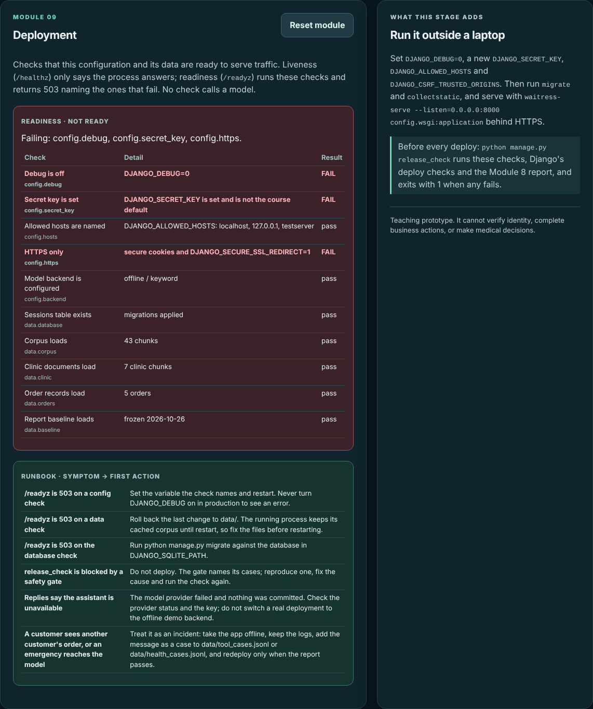
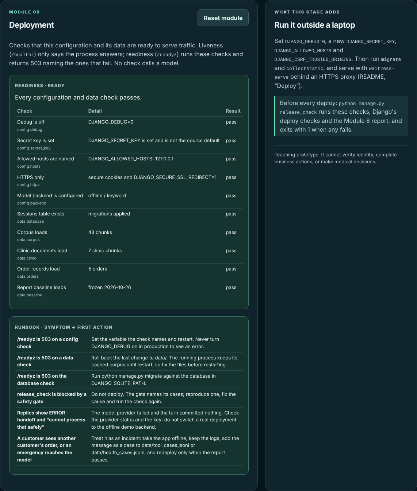
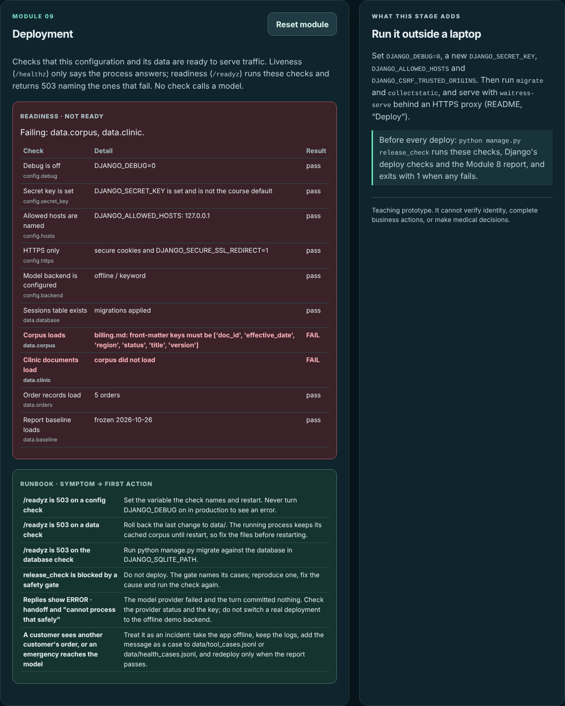

# Module 9 — Deployment and Runbook

> **Project:** Customer Support LLM
>
> **Build:** Web app v0.9 — production settings, readiness checks, a release check and a runbook
>
> **Learning loop:** Build → Break → Measure → Improve
>
> **Code:** [The evolving Django app](https://github.com/faheemkhaskheli9/Customer-Support-LLM/tree/main/webapp)

## Module mission

Module 8 answers one question: **can this change ship?** A passing report says nothing about the machine it ships to. The same code fails in production when debug is on, when the secret key is the one in the course repository, when the database was never migrated, or when someone breaks one front-matter line in the corpus.

This module answers the next question: **can this configuration serve customers, and what do we do when it cannot?** It adds:

- production settings read from `DJANGO_*` variables;
- ten readiness checks that call no model and print no secret;
- two endpoints: `/healthz` for liveness and `/readyz` for readiness;
- one command, `python manage.py release_check`, that exits with 1 when anything fails;
- a runbook: each symptom with its first action.

Nothing here performs refunds, order changes, diagnosis or prescribing. Everything still uses fictional data.

## What you will build

A new card appears in the navigation: **09 · Deployment**, at `/?stage=9`. The page has no conversation. It shows the readiness checks for the configuration that served it, and the runbook.

From `webapp/`:

~~~bash
python -m pip install -r requirements-dev.txt
python manage.py migrate
python manage.py runserver
~~~

Open `http://127.0.0.1:8000/?stage=9`. On a laptop the page is red, and that is correct: the course defaults are not a deployment.

## 1. Production settings come from the environment

Every setting that must differ in production is read from a variable in [`config/settings.py`](https://github.com/faheemkhaskheli9/Customer-Support-LLM/blob/main/webapp/config/settings.py). The commented lines in `.env.example` list them:

| Variable | Production value |
|---|---|
| `DJANGO_DEBUG` | `0` |
| `DJANGO_SECRET_KEY` | a new value from `python -c "import secrets; print(secrets.token_urlsafe(50))"` |
| `DJANGO_ALLOWED_HOSTS` | your host name, e.g. `support.example.com` |
| `DJANGO_CSRF_TRUSTED_ORIGINS` | `https://` plus that host |
| `DJANGO_BEHIND_PROXY` | `1` when a TLS proxy sets `X-Forwarded-Proto` |
| `DJANGO_SQLITE_PATH` | a path on persistent storage (optional) |
| `DJANGO_HSTS_SECONDS` | defaults to `3600` when debug is off |

Three rules shape the file:

- **Debug off turns the safe defaults on.** Secure cookies, the HTTPS redirect and HSTS follow `DEBUG`. Forgetting one variable does not leave cookies sent over plain HTTP.
- **No key, no start.** With debug off and no `DJANGO_SECRET_KEY`, settings raise `ImproperlyConfigured`. The app refuses to start rather than sign sessions with an empty key.
- **The course key is a known value.** `DEV_SECRET_KEY` is in the public repository, so a readiness check fails if production uses it.

Static files: with debug off, `runserver` serves none, so WhiteNoise serves the output of `collectstatic`. It is only added to the middleware when debug is off.

## 2. Ten readiness checks

[`support/ops.py`](https://github.com/faheemkhaskheli9/Customer-Support-LLM/blob/main/webapp/support/ops.py) runs ten checks. Five check the configuration:

| Key | Passes when |
|---|---|
| `config.debug` | debug is off |
| `config.secret_key` | the key is set and is not the course default |
| `config.hosts` | allowed hosts are named and none is `*` |
| `config.https` | secure cookies and the HTTPS redirect are on |
| `config.backend` | the backend and retrieval mode are known, and their variables are set |

Five check the database and data:

| Key | Passes when |
|---|---|
| `data.database` | the sessions and feedback tables exist |
| `data.corpus` | the corpus loads from disk (43 chunks) |
| `data.clinic` | the clinic documents load (7 chunks) |
| `data.orders` | the order records load (5 orders) |
| `data.baseline` | the Module 8 baseline loads |

Three decisions matter more than the list:

- **No check calls a model.** A readiness probe runs every few seconds. A check that calls the provider costs money each time and fails whenever the provider is slow.
- **Missing variables are named, never their values.** `config.backend` says `missing OPENAI_API_KEY`; with a key set, the detail is `openai / keyword` and the key never appears.
- **Data is read from disk, not from the cache.** `get_retriever()` is cached per process. If readiness asked the cache, a broken corpus file would pass until the next restart, and then the app would fail. Reading the files shows the break before the restart.

Every check returns the same shape, so the page, the endpoint and the command share one list:

~~~python
def check(key: str, label: str, ok: bool, detail: str) -> dict:
    return {"key": key, "label": label, "ok": ok, "detail": detail}
~~~

An unreachable database or an unreadable file is a failed check, not a crash.

## 3. Liveness and readiness are different questions

~~~python
def healthz(request):
    """Liveness: the process answers. No database, files or model are touched."""
    return JsonResponse({"status": "ok"})

def readyz(request):
    """Readiness: names the failing checks, never their details, since the endpoint is public."""
    result = readiness()
    return JsonResponse({"status": "ready" if result["ready"] else "not ready", "failing": result["failing"]},
                        status=200 if result["ready"] else 503)
~~~

A platform acts on them differently:

- **Liveness fails → restart the process.** If `/healthz` read the corpus, a broken file would make the platform restart the app forever, and a restart cannot fix a file.
- **Readiness fails → stop sending traffic.** The process stays up so someone can read why.

`/readyz` returns keys such as `data.corpus`, not the detail. The detail can contain file names, host names or error text, and the endpoint has no login. The page and the command show the details to whoever runs them.

## 4. One release command

[`release_check`](https://github.com/faheemkhaskheli9/Customer-Support-LLM/blob/main/webapp/support/management/commands/release_check.py) runs three things and fails if any fails:

1. the ten readiness checks;
2. Django's `check --deploy`, with warnings treated as failures;
3. the Module 8 report.

~~~bash
python manage.py migrate
python manage.py collectstatic --noinput
python manage.py release_check
echo $?    # 0 when ready to deploy, 1 otherwise
~~~

With production variables set and the offline backend:

~~~text
pass  config.debug         Debug is off (DJANGO_DEBUG=0)
pass  config.secret_key    Secret key is set (DJANGO_SECRET_KEY is set and is not the course default)
pass  config.hosts         Allowed hosts are named (DJANGO_ALLOWED_HOSTS: support.example.com)
pass  config.https         HTTPS only (secure cookies and DJANGO_SECURE_SSL_REDIRECT=1)
pass  config.backend       Model backend is configured (offline / keyword)
pass  data.database        Database tables exist (migrations applied)
pass  data.corpus          Corpus loads (43 chunks)
pass  data.clinic          Clinic documents load (7 clinic chunks)
pass  data.orders          Order records load (5 orders)
pass  data.baseline        Report baseline loads (frozen 2026-10-26)
System check identified no issues (2 silenced).
Evaluation report: pass
Ready to deploy.
~~~

The two silenced checks are HSTS `includeSubDomains` and preload. They commit the whole domain to HTTPS, so they are the domain owner's decision, not the app's.

Why one command and not three? A release script that runs three commands can forget one. The failure message lists every reason at once, for example `Not ready to deploy: readiness: config.debug, config.https | Django deploy checks`.

## 5. Serve it

~~~bash
waitress-serve --listen=127.0.0.1:8000 --trusted-proxy=127.0.0.1 --trusted-proxy-headers=x-forwarded-proto config.wsgi:application
~~~

Waitress runs on Windows, macOS and Linux. Put an HTTPS proxy in front of it and set `DJANGO_BEHIND_PROXY=1`. Waitress drops `X-Forwarded-Proto` from a proxy it does not trust; Django then sees every request as plain HTTP and redirects it to HTTPS in a loop. Naming the proxy prevents that.

Point the platform's liveness probe at `/healthz` and its readiness probe at `/readyz`. With production settings, the page turns green:

## 6. The runbook

The runbook is `RUNBOOK` in `support/ops.py`, so the page and this article quote one list. Each row is a symptom someone can see and the first thing to do:

| Symptom | First action |
|---|---|
| `/readyz` is 503 on a config check | Set the variable the check names and restart. Never turn `DJANGO_DEBUG` on in production to see an error. |
| `/readyz` is 503 on a data check | Roll back the last change to `data/`. The running process keeps its cached corpus until restart, so fix the files before restarting. |
| `/readyz` is 503 on the database check | Run `python manage.py migrate` against the database in `DJANGO_SQLITE_PATH`. |
| `release_check` is blocked by a safety gate | Do not deploy. The gate names its cases; reproduce one, fix the cause and run the check again. |
| Replies show `ERROR · handoff` and "cannot process that safely" | The model provider failed and the turn committed nothing. Check the provider status and the key; do not switch a real deployment to the offline demo backend. |
| A customer sees another customer's order, or an emergency reaches the model | Treat it as an incident: take the app offline, keep the logs, add the message as a case to `data/tool_cases.jsonl` or `data/health_cases.jsonl`, and redeploy only when the report passes. |

The last row connects the runbook to Module 8. An incident becomes a case. The case becomes part of the report, so the same failure blocks every later release.

## 7. Break it

Start from a working production configuration (the variables in section 1, the offline backend, a migrated database). Change one thing at a time, predict the result, then run `/readyz` and `release_check`.

| Break | `/readyz` | Failing | `release_check` |
|---|---|---|---|
| None | 200 | — | Ready to deploy |
| `DJANGO_DEBUG=1` | 503 | `config.debug`, `config.https` | exit 1: readiness and 5 Django deploy warnings |
| No `DJANGO_SECRET_KEY` | — | — | the app does not start: `ImproperlyConfigured` |
| `DJANGO_SECRET_KEY` set to the course default | 503 | `config.secret_key` | exit 1: readiness and Django's `security.W009` |
| `SUPPORT_MODEL_BACKEND=openai`, no key or model | 503 | `config.backend` | exit 1: `missing OPENAI_API_KEY, OPENAI_MODEL` |
| `status:` renamed in `billing.md` front matter | 503 | `data.corpus`, `data.clinic` | exit 1: readiness, and the report could not run |
| `DJANGO_SQLITE_PATH` points at a new file | 503 | `data.database` | exit 1: `run python manage.py migrate` |
| `routing.matched` raised to 16 in the baseline | **200** | — | exit 1: report blocked by Module 3 routing: Expected routes |

What each row teaches:

- **Debug on** fails two checks, because turning debug on also turns off the HTTPS defaults. One variable, two problems, and Django's own deploy checks add five warnings for the same settings.
- **No secret key** never reaches a check. Refusing to start is the strongest check there is.
- **The course key** fails twice. Django warns only because this key is shorter than 50 characters; a long key copied from a public repository would pass Django's check. Only the app knows which string is public.
- **The OpenAI backend without a key** names both variables. The detail never contains a key value, even when one is set.
- **A broken corpus file** fails two checks, and the detail names the file and the missing key. In a fresh process, the pages that load the retriever (stage 5 and the support agent at `/`) then return 500, while `/healthz` and the other stages still answer. That is why the runbook says to fix the files before restarting: the running process still has a good cached corpus.
- **A new database file** fails only `data.database`. Migrations are part of a deployment, not something the app does on start.
- **A raised baseline** is the only row where `/readyz` stays 200. The configuration is fine; the release is not. Readiness asks whether this process can serve; the report asks whether this code should. They are different gates, and `release_check` runs both.

While measuring this table, the broken corpus row found a bug: the report reloads the corpus, raised `ValueError` and `release_check` ended in a traceback. It now catches the error and reports `report could not run`, so a broken data file gives the same clean exit 1 as every other row. The test `test_release_check_command` covers it.

## 8. Measure

On a laptop (`runserver`, course defaults): 7 of 10 checks pass; `config.debug`, `config.secret_key` and `config.https` fail.

With production variables (offline backend, migrated database): 10 of 10 checks pass, `check --deploy` reports no issues (2 silenced), the report passes, and `release_check` exits with 0.

Across the breaks in section 7:

| Measure | Result |
|---|---|
| Breaks that `/readyz` catches | 5 of 7 (a missing key stops the app first; the raised baseline is not its job) |
| Breaks that `release_check` catches | 6 of 6 that start, plus the missing key that stops the app |
| Checks that call a model | 0 |
| Secret values in any check detail | 0 |

What readiness does **not** establish: that the model provider answers, that a live model behaves like the offline one, or that the deployment can survive a server failure. A production deployment with `SUPPORT_MODEL_BACKEND=offline` passes every check, because the offline backend is a valid configuration for a demo.

## 9. Tests you can run offline

From `webapp/`:

~~~bash
python manage.py check
python manage.py test support
~~~

All 60 tests run without a network or API key. The 5 Module 9 tests are in the `Module9DeploymentTests` class in [`support/tests.py`](https://github.com/faheemkhaskheli9/Customer-Support-LLM/blob/main/webapp/support/tests.py). They cover:

- `/healthz` always answering, and `/readyz` returning 503 with `config.secret_key` and `config.https` on the course defaults and 200 with production settings;
- broken orders and corpus files failing their checks with the error as the detail, while the baseline check still passes;
- the OpenAI backend naming its missing variables and never a key value;
- `release_check` passing with production settings, failing on a blocked report, a report that cannot run and the course defaults;
- the page showing the checks and the runbook, with no conversation.

The test runner sets debug off, so the course defaults fail two checks in the tests and three under `runserver`.

## 10. Common mistakes

**One health endpoint for both probes.** A liveness probe that reads data restarts a process that a restart cannot fix.

**Calling the model in a readiness check.** It costs money every few seconds and makes readiness depend on someone else's uptime.

**Printing details on a public endpoint.** Error text can name files, hosts and settings. Return keys; show details to operators.

**Checking the cache instead of the files.** The app looks healthy until the next restart, then fails.

**Turning debug on in production to read an error.** It shows settings and stack traces to anyone. Read the logs and the readiness details instead.

**Running migrations on start.** Two instances starting together can race. Migrate as a deployment step.

**Treating `/readyz` 200 as permission to release.** The report is a separate gate.

## Module project

Extend the web app into **Customer Support Assistant v0.9** and show:

1. **Production settings** read from the environment, with the app refusing to start without a secret key.
2. **Readiness checks** for configuration and data that call no model and name missing variables without values.
3. **Two endpoints**: liveness that touches nothing, readiness that returns 503 with keys only.
4. **One release command** that runs readiness, the framework's deploy checks and the Module 8 report, and exits with 1 when any fails.
5. **A runbook** in code, shown on the page, where each symptom has one first action.

**Improve:** add a `DJANGO_DEPLOYED=1` flag and a check that fails when it is set and the backend is `offline`. Then confirm that the course defaults still pass locally and that a deployment cannot ship the demo backend by mistake.

### Assessment

- **Settings — 20%:** every production value from the environment; safe defaults when debug is off.
- **Readiness design — 30%:** liveness and readiness separated, no model calls, no secrets, data read from disk.
- **Release command — 20%:** one exit code that a script can trust.
- **Break exercises — 20%:** each row of section 7 run and explained.
- **Runbook — 10%:** each symptom is observable and has one first action.

### Passing conditions

- Overall score of at least 70%.
- `/readyz` returns 503 on the course defaults and 200 with production settings.
- `release_check` exits with 1 for every break in section 7 that starts, and the app refuses to start without a key.
- No check detail contains a secret value.
- No real customer or patient data is used anywhere.

## Limits of this module

- **Readiness does not check the model provider.** Provider failures show up as handoffs in replies, and the runbook covers them.
- **SQLite on one server** is not a highly available database. Sessions are lost if that disk is lost.
- **There is no alerting.** Something must call `/readyz` and tell a person when it fails.
- **There is no rollback command.** The runbook says to roll back; how depends on the platform.
- **The offline backend passes readiness.** It is valid for a demo; the improve exercise closes that gap.

## What comes next

Module 9 is the last module. The support agent at `/` combines Modules 1–7 in one conversation, Module 8 decides whether a change can ship, and Module 9 decides whether a configuration can serve it.
